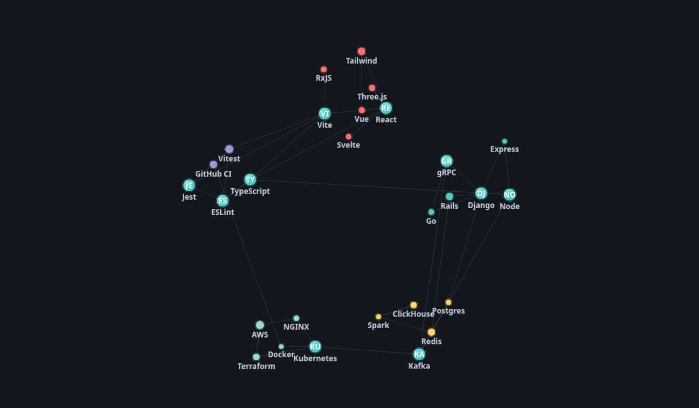
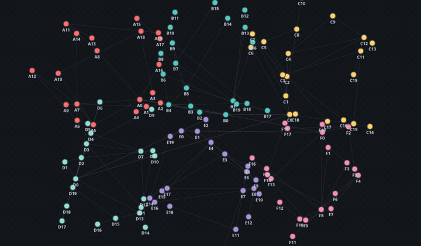
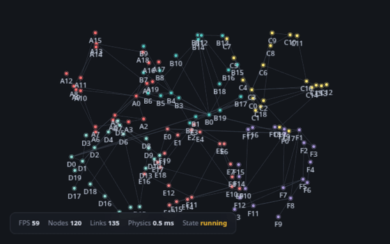
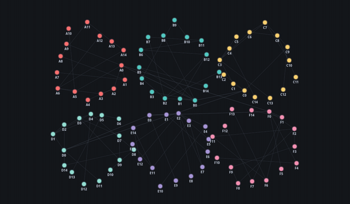
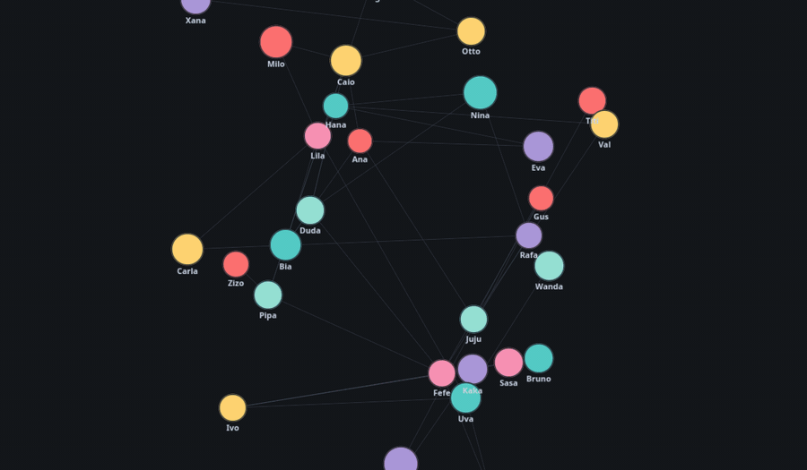
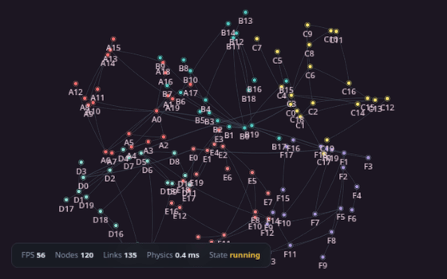
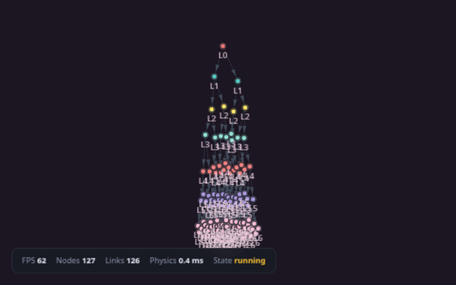
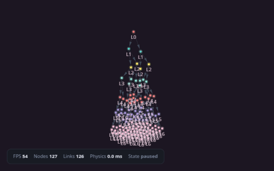

<p align="center">
  
</p>

<p align="center">
  <a href="https://www.npmjs.com/package/@yurialvesbordin/graphium"></a>
  <a href="https://opensource.org/licenses/MIT"></a>
  <a href="http://www.typescriptlang.org/"></a>
  <a href="https://developer.mozilla.org/en-US/docs/Web/API/WebGL_API"></a>
</p>

<p align="center">
  High-performance WebGL2 graph visualization with silk-smooth force physics, curved edges, node images, and a fluent API.
</p>



## Installation

```bash
npm install @yurialvesbordin/graphium
```

## Usage

```ts
import { Graphium } from '@yurialvesbordin/graphium';

const graph = Graphium.create({
  container: document.getElementById('graph-container'),
  autoStart: true,
  autoFit: true,
  physics: { preset: 'silk' },
  theme: { name: 'midnight' },
});

graph
  .addNode('alice', { label: 'Alice' })
  .addNode('bob',   { label: 'Bob'   })
  .addNode('carol', { label: 'Carol' });

graph.link('alice', 'bob').link('bob', 'carol').link('carol', 'alice');

graph.fit(80);
```

## Showcase

### Force-directed physics

A 120 node clustered graph reorganizing itself after a disturbance. The solver
combines repulsion, link springs, gravity, damping, and collision handling while
spatial hashing keeps neighbor lookups near O(n). The graph sleeps automatically
when it settles, dropping CPU usage to near zero.



### Curved edges

Edge curvature adjusted at runtime from straight to strongly curved in both
directions. Curves are computed on the GPU, so styling thousands of edges costs
no extra CPU. Positive values curve one way, negative values the other.



### Smooth edge length control

Every link carries its own rest length, and the solver eases toward new values
instead of jumping. Changing a length wakes the graph up automatically, so even
a fully settled layout reorganizes itself gracefully.

```ts
graph.link('alice', 'bob', { restLength: 240 });
graph.linkById('alice~bob~0').restLength(90);
```

### Built-in themes

The four bundled themes (midnight, light, slate, sunset) switching at runtime.
Each theme controls background, node palette, edge styling, labels, and the
hover and selection rings. Custom themes merge over the current one, so you can
override only what you need.



### Node images

Toggling node images on and off. Any node can take an image (URL or canvas
data URL) rendered inside the circle with cover fit. Images upload to the GPU
through a texture atlas, keeping draw calls minimal.



### Arrow heads

Turning directed arrow heads on. Arrows follow the edge path, respect
curvature, and scale with zoom.



### Tree layout

A binary tree dataset settling under the same force solver. When hierarchical
data needs cleaner separation, edge separation tuning untangles crossings, and
any dataset type can be swapped at runtime.



### Click to focus and inspect

Clicking a node focuses the camera on it and opens the inspector with live
degree, position, and velocity. Dragging works with momentum, the wheel zooms,
and every interaction emits events you can subscribe to.



## Documentation

Complete guides live in the docs directory:

- Getting Started - installation, first graph, handles, cleanup
- Physics Configuration - presets and fine-tuning the simulation
- Theming Guide - built-in and custom themes
- Events & Interaction - events, interaction, accessibility
- Node Images - custom images as node backgrounds
- Performance Tuning - optimization of rendering and physics

## License

MIT
