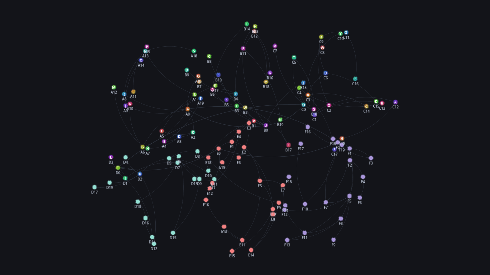
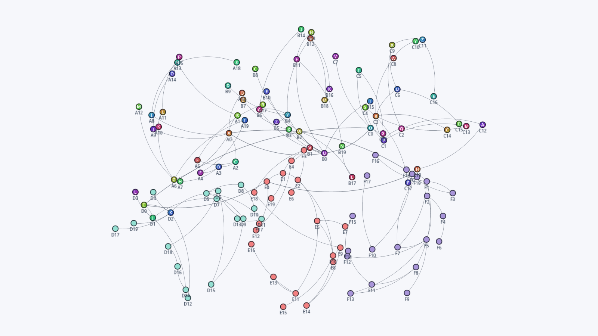
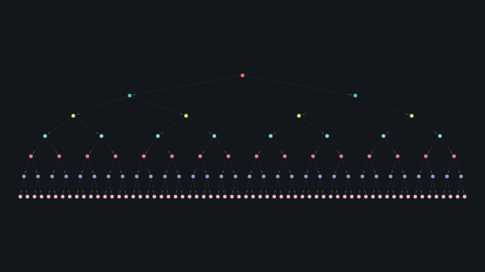

# Graphium

High-performance WebGL2 graph visualization with silk-smooth force physics, curved edges and node images.

<table>
  <tr>
    <td width="50%"></td>
    <td width="50%"></td>
  </tr>
  <tr>
    <td align="center">Curved edges rendered on the GPU</td>
    <td align="center">Built-in light theme</td>
  </tr>
</table>

Install: `npm install graphium`

Full guides live in the [`docs/`](docs) directory:

- [Getting Started](docs/getting-started.md)
- [Physics Configuration](docs/physics-configuration.md)
- [Theming Guide](docs/theming-guide.md)
- [Node Images](docs/node-images.md)
- [Events & Interaction](docs/events-interaction.md)
- [Performance Tuning](docs/performance-tuning.md)

Interactive playground: run `npm run demo` and open the served URL.

License: MIT