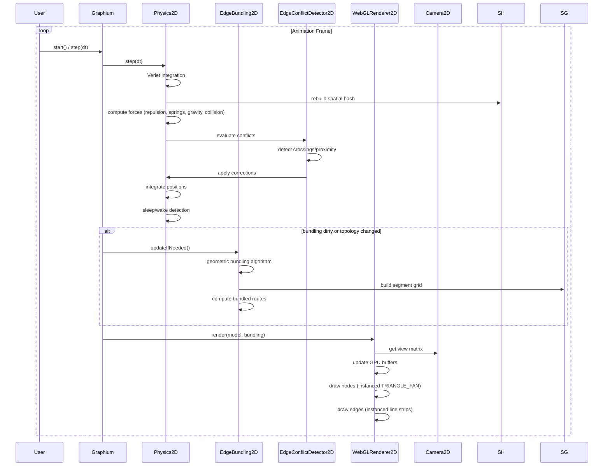
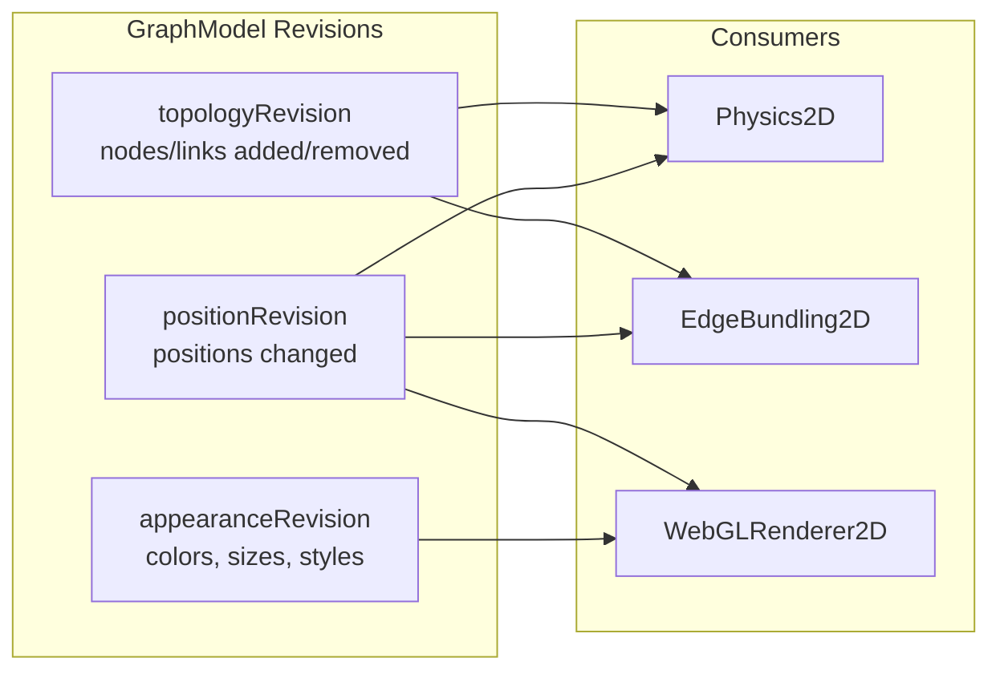
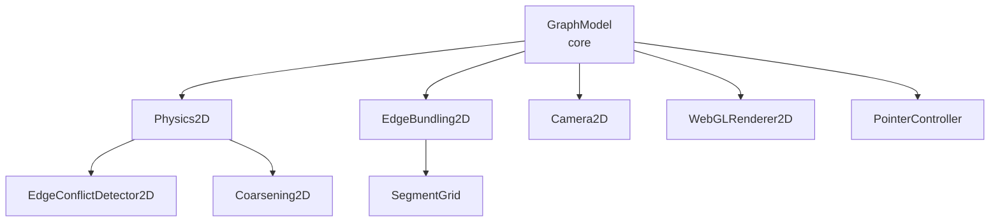

# Architecture Overview

Graphium follows a **modular, data-oriented architecture** where each subsystem operates on a shared `GraphModel` -- a dense, contiguous TypedArray storage. The `Graphium` facade orchestrates all subsystems.

---

## High-Level Module Diagram

```mermaid
graph TD
    subgraph "User API"
        G2D[Graphium Facade]
    end

    subgraph "Core Data"
        GM[GraphModel<br/>TypedArray Storage]
    end

    subgraph "Physics Engine"
        PH[Physics2D<br/>Verlet Integration]
        SH[SpatialHash2D<br/>O(1) Neighborhood]
        EC[EdgeConflictDetector2D<br/>Crossing/Proximity]
        CO[Coarsening2D<br/>Multi-Level HEM]
    end

    subgraph "Edge Bundling"
        EB[EdgeBundling2D<br/>Geometric Routing]
        SG[SegmentGrid<br/>Spatial Index]
    end

    subgraph "Rendering"
        CAM[Camera2D<br/>Viewport/Transform]
        WGL[WebGLRenderer2D<br/>Instanced Draws]
    end

    subgraph "Interaction"
        PC[PointerController<br/>Mouse/Touch/Pen]
    end

    G2D --> GM
    G2D --> PH
    G2D --> EB
    G2D --> CAM
    G2D --> WGL
    G2D --> PC

    PH --> GM
    PH --> SH
    PH --> EC
    PH --> CO

    EB --> GM
    EB --> SG

    EC --> GM
    EC -.-> EB

    CO --> GM

    WGL --> GM
    WGL --> CAM
    WGL -.-> EB

    PC --> GM
    PC --> CAM
    PC --> SH
```

---

## Data Flow Per Frame



---

## Module Responsibilities

| Module | File | Responsibility |
|--------|------|----------------|
| **GraphModel** | `src/core/GraphModel.js` | Dense storage: positions, velocities, topology, appearance in contiguous TypedArrays |
| **Physics2D** | `src/physics/Physics2D.js` | Force-directed simulation: Verlet, forces, constraints, sleep |
| **SpatialHash2D** | `src/physics/SpatialHash2D.js` | O(1) spatial grid for neighbor queries |
| **EdgeConflictDetector2D** | `src/physics/EdgeConflict2D.js` | Crossing detection, proximity/overlap correction |
| **Coarsening2D** | `src/physics/Coarsening2D.js` | Heavy-Edge Matching for multi-level initialization |
| **EdgeBundling2D** | `src/physics/EdgeBundling2D.js` | Geometric route computation, segment compatibility |
| **SegmentGrid** | `src/physics/EdgeBundling2D.js` | Spatial index for edge segments |
| **Camera2D** | `src/render/Camera2D.js` | Viewport, zoom/pan, world↔screen transforms |
| **WebGLRenderer2D** | `src/render/WebGLRenderer2D.js` | Instanced WebGL2 rendering, avatar atlas, shaders |
| **PointerController** | `src/interaction/PointerController.js` | Pointer events, drag/pan/zoom/pinch, picking |

---

## Revision System

Graphium uses **revision counters** to track dirty state without polling:



- **Topology revision** → rebuild spatial hash, rebuild bundles
- **Position revision** → update forces, update bundles incrementally
- **Appearance revision** → re-upload GPU buffers for colors/styles

---

## Zero-GC Hot Paths

All performance-critical loops use **pre-allocated TypedArrays**. See `Physics2D` in `src/physics/Physics2D.js` and `SpatialHash2D` in `src/physics/SpatialHash2D.js`.

- Physics2D: `this.neighbors = new Int32Array(maxNeighbors)` -- reused per frame
- Physics2D: `this.edgeConflicts.evaluate(true)` -- reuses internal buffers
- SpatialHash2D: open addressing, no Map/Set in hot path
  - `this.buckets = new Map()` -- only for cell → entry index
  - `this.next = new Int32Array(capacity)` -- linked list in array

---

## Extension Points

| Extension | How |
|-----------|-----|
| **Custom forces** | Subclass `Physics2D` (see `src/physics/Physics2D.js`), override `_applyRepulsionAndCollisions()` etc. |
| **Custom bundling** | Implement `RouteProvider` interface, call `physics.setRouteProvider()` (see `src/physics/Physics2D.js`) |
| **Custom rendering** | Extend `WebGLRenderer2D` (see `src/render/WebGLRenderer2D.js`), override `render()` or shader sources |
| **Custom interaction** | Replace `PointerController` (see `src/interaction/PointerController.js`), implement `on(type, cb)` interface |

---

## Dependencies Between Modules



- **GraphModel** is the single source of truth -- no module owns data
- **Physics2D** and **EdgeBundling2D** are the only modules that *write* positions
- **WebGLRenderer2D** is read-only on model data
- **PointerController** writes only via `Graphium` facade methods