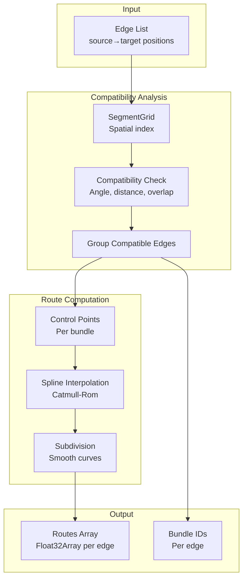
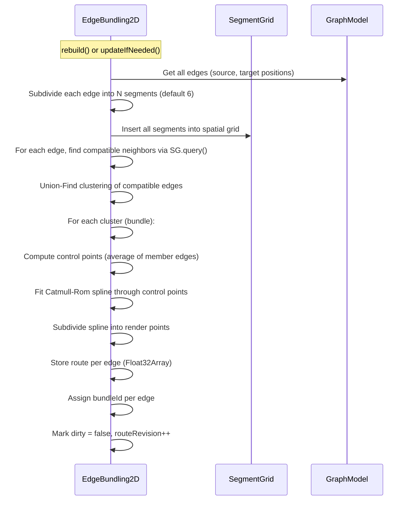
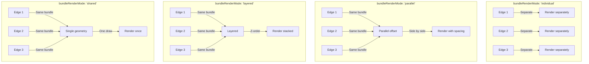
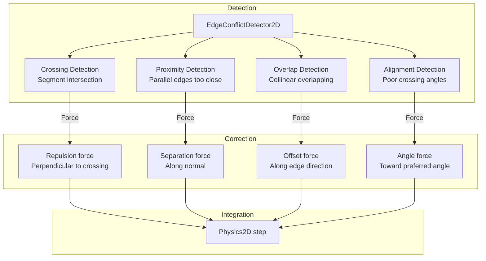
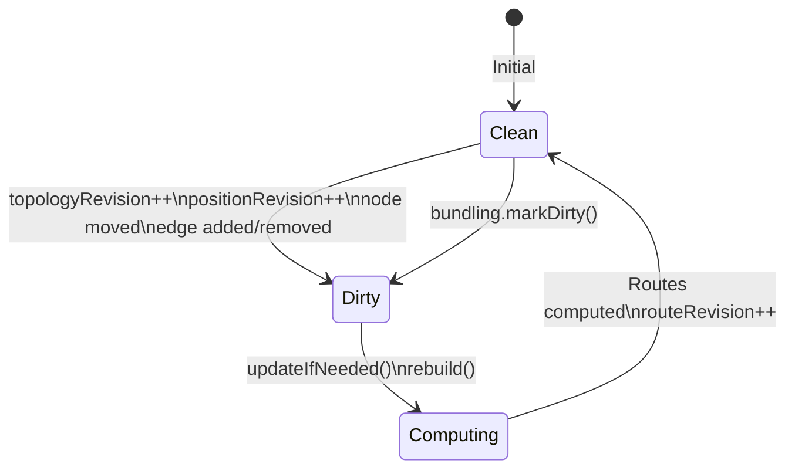

# Edge Bundling

Graphium implements **geometric edge bundling** to reduce visual clutter in dense graphs. Edges with similar paths are grouped into smooth bundles.

---

## Bundling Algorithm Overview



---

## Geometric Compatibility

Two edges are **compatible** for bundling if:

```mermaid
graph LR
    A[Edge A\nP0→P1→P2→P3] -->|Check| C{Compatible?}
    B[Edge B\nQ0→Q1→Q2→Q3] -->|Check| C

    C -->|Angle| D[Angle between\ncorresponding segments\n< threshold]
    C -->|Distance| E[Average distance\nbetween segments\n< threshold]
    C -->|Overlap| F[Segment projections\noverlap significantly]
    C -->|Length| G[Length ratio\nwithin bounds]
    C -->|Nodes| H[Don't share\nendpoints\n(optional)]

    D & E & F & G & H -->|All pass| I[Bundle Together]
```

**Compatibility metrics** (from `EdgeBundling2D` in `src/physics/EdgeBundling2D.js`):

- For each segment pair (same index in subdivided edges):
  - `angle = Math.abs(angleBetween(segA, segB))` -- radians
  - `dist = averageDistance(segA, segB)` -- world units
  - `overlap = projectionOverlap(segA, segB)` -- 0-1
  - `lengthRatio = Math.max(lenA, lenB) / Math.min(lenA, lenB)`

- Pass if:
  - `angle < bundleCompatibility` (default 0.65 rad ~37°)
  - `dist < bundleRadius` (default 180px)
  - `overlap > 0.3` (minimum overlap)
  - `lengthRatio < maxLengthRatio` (default 2.5)

---

## Bundle Formation Process



---

## Subdivision & Splines

### Edge Subdivision
Each straight edge is subdivided into **equidistant points**:

```
P0 (source) ──●───●───●───●── P3 (target)
              │   │   │   │
           6 segments = 7 points
```

- **Subdivisions**: `bundleSubdivisions` (default 6)
- **Purpose**: Enables per-segment compatibility comparison

### Control Point Computation
For a bundle with edges E₁...Eₙ, each subdivided into points Pᵢ₀...Pᵢₖ:

```
Control Point j = Average of P₁ⱼ, P₂ⱼ, ..., Pₙⱼ
                + Node avoidance offset
```

**Node avoidance** pushes control points away from node interiors. See `EdgeBundling2D.rebuild()` in `src/physics/EdgeBundling2D.js`:

- For each control point, check nodes within `bundleRadius`
- If control point inside node radius + margin, push outward along normal

### Catmull-Rom Spline

Smooth curve through control points. See `EdgeBundling2D.rebuild()` in `src/physics/EdgeBundling2D.js`:

- Catmull-Rom formula: `P(t) = 0.5 * ((2*P1) + (-P0+P1)*t + (2*P0-5*P1+4*P2-P3)*t² + (-P0+3*P1-3*P2+P3)*t³)`
- Applied for each segment between control points

---

## Render Modes



| Mode | Visual | Use Case | Performance |
|------|--------|----------|-------------|
| `'individual'` | Separate lines | Debugging, few edges | Slowest |
| `'parallel'` | Side-by-side ribbons | Default, general use | Fast |
| `'layered'` | Stacked with gaps | Hierarchical emphasis | Fast |
| `'shared'` | Single merged line | Maximum decluttering | Fastest |

---

## Configuration

```javascript
bundling: {
  // Enable/disable
  edgeBundling: false,

  // Algorithm
  bundleMode: 'geometric',        // Only 'geometric' implemented
  bundleStrength: 0.35,           // How strongly edges attract to bundle center (0-1)
  bundleIterations: 3,            // Refinement iterations
  bundleSubdivisions: 6,          // Segments per edge for compatibility
  bundleCompatibility: 0.65,      // Max angle (rad) for compatibility
  bundleRadius: 180,              // Search radius for neighbors
  nodeSeparationLength: 50,       // Min distance from node centers

  // Bundle limits
  maxBundleSize: 32,              // Max edges per bundle
  maxBundlePairs: 10000,          // Max compatibility checks

  // Style preservation
  preserveEdgeStyle: true,        // Keep per-edge color/width/dash
  preserveEdgeIdentity: true,     // Keep edge selectable individually
  avoidNodeInteriors: true,       // Push bundles away from nodes
  bundleShortEdges: false,        // Bundle edges shorter than threshold
  avoidSharedNodes: false,        // Don't bundle edges sharing endpoints

  // Performance
  thresholdNodes: 3,              // Min nodes before bundling activates
  movementThreshold: 1.5,         // Position change to trigger rebuild

  // Render mode
  bundleRenderMode: 'parallel'    // 'parallel' | 'layered' | 'shared' | 'individual'
}
```

---

## Edge Conflict Detection

The **EdgeConflictDetector2D** works alongside bundling to fix visual issues:



### Conflict Types

| Type | Detection | Correction |
|------|-----------|------------|
| **Crossing** | Segment intersection test | Repulsion perpendicular to both edges |
| **Proximity** | Distance < `edgeMinSeparation` | Separation along normal |
| **Overlap** | Collinear + overlapping projections | Offset along edge direction |
| **Alignment** | Crossing angle far from `preferredCrossingAngle` (π/2) | Torque toward 90° |

### Conflict Energy

See `EdgeConflictDetector2D` in `src/physics/EdgeConflict2D.js` and `Physics2D._applyEdgeConflictCorrections()` in `src/physics/Physics2D.js`.

- `edgeConflictEnergy = Σ(severity²) for all conflict pairs`
- Severity based on:
  - Crossing: angle deviation from 90°
  - Proximity: inverse distance
  - Overlap: overlap length / edge length
  - Alignment: angle difference from preferred

**Physics integration** in `Physics2D._applyEdgeConflictCorrections()`:
- Corrections applied as position deltas
- `correction *= edgeConflictDamping` (default 0.85)
- `correction = clamp(correction, maxEdgeCorrection)` (default 12px max)
- Preserve edge length: `targetLength = restLength * preserveEdgeLength + currentLength * (1 - preserveEdgeLength)`

---

## Bundle Lifecycle



**Dirty triggers:**
- `graph.addNode()` / `removeNode()`
- `graph.addLink()` / `removeLink()`
- `graph.setData()`
- Node position changed (drag, physics)
- `bundling.markDirty()` called manually
- `graph.rebuildEdgeBundles()`

---

## API

See `Graphium` in `src/Graphium.js` and `EdgeBundling2D` in `src/physics/EdgeBundling2D.js`.

- `graph.bundling` -- `EdgeBundling2D` instance
- `graph.rebuildEdgeBundles()` -- force rebuild all routes
- `graph.clearEdgeBundles()` -- clear all bundled routes
- `graph.getEdgeRoute(linkId)` -- `Float32Array` [x0,y0,x1,y1,...] or null
- `graph.getBundleInfo(linkId)` -- `{ linkIndex, bundleId, bundleSize, mode, pointCount }`
- `graph.setBundlingOptions({ bundleStrength, bundleRenderMode, bundleIterations, ... })`

---

## Performance

| Scenario | Bundle Time | Notes |
|----------|-------------|-------|
| 100 edges | ~2ms | Negligible |
| 1,000 edges | ~15ms | Acceptable |
| 5,000 edges | ~80ms | Consider `thresholdNodes` |
| 10,000 edges | ~200ms | Disable for real-time |

**Optimization tips:**
- Increase `thresholdNodes` to delay bundling on small graphs
- Reduce `bundleSubdivisions` for faster computation
- Set `bundleRenderMode: 'shared'` for maximum GPU efficiency
- Enable `edgeBundling` for complex graphs when bundling is needed
- Use `movementThreshold` to avoid rebuild on tiny movements

---

## Debugging

See `EdgeBundling2D` in `src/physics/EdgeBundling2D.js`.

- `graph.bundling.bundleSizes` -- `Int32Array` per bundle
- `graph.bundling.routes` -- `Array` of `Float32Array`
- `graph.bundling.routeRevision` -- current revision number
- Event: `graph.on('bundleupdated', (event) => { console.log(event.revision); })`