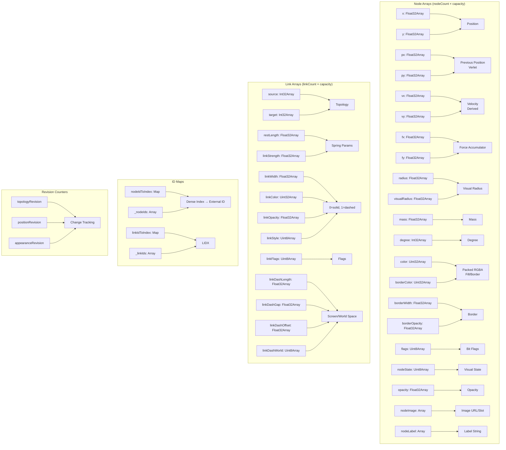
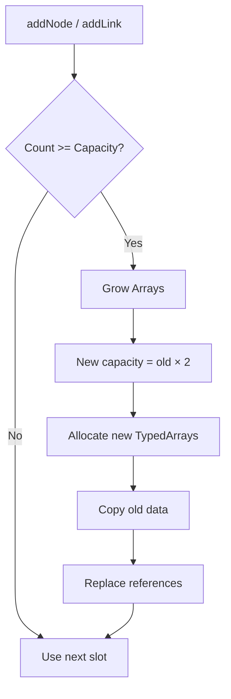
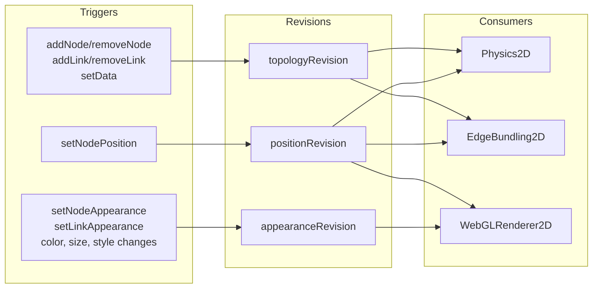

# Data Model (GraphModel)

`GraphModel` is the **central data store** -- all graph data lives in contiguous TypedArrays for cache efficiency and zero-GC performance.

---

## Storage Layout



---

## TypedArray Design

| Array | Type | Size | Purpose |
|-------|------|------|---------|
| `x`, `y` | `Float32Array` | `nodeCount` | Current position |
| `px`, `py` | `Float32Array` | `nodeCount` | Previous position (Verlet) |
| `vx`, `vy` | `Float32Array` | `nodeCount` | Velocity (derived) |
| `fx`, `fy` | `Float32Array` | `nodeCount` | Force accumulator |
| `radius` | `Float32Array` | `nodeCount` | Physical radius |
| `visualRadius` | `Float32Array` | `nodeCount` | Render radius |
| `mass` | `Float32Array` | `nodeCount` | Physics mass |
| `degree` | `Int32Array` | `nodeCount` | Link count |
| `color` | `Uint32Array` | `nodeCount` | Packed RGBA fill |
| `borderColor` | `Uint32Array` | `nodeCount` | Packed RGBA border |
| `borderWidth` | `Float32Array` | `nodeCount` | Border width |
| `borderOpacity` | `Float32Array` | `nodeCount` | Border opacity |
| `flags` | `Uint8Array` | `nodeCount` | Bit flags |
| `nodeState` | `Uint8Array` | `nodeCount` | Visual state enum |
| `opacity` | `Float32Array` | `nodeCount` | Node opacity |
| `nodeImage` | `Array<string|null>` | `nodeCount` | Image URL or atlas slot |
| `nodeLabel` | `Array<string|null>` | `nodeCount` | Text label |
| `source` | `Int32Array` | `linkCount` | Source node index |
| `target` | `Int32Array` | `linkCount` | Target node index |
| `restLength` | `Float32Array` | `linkCount` | Spring rest length |
| `linkStrength` | `Float32Array` | `linkCount` | Spring constant |
| `linkWidth` | `Float32Array` | `linkCount` | Line width |
| `linkColor` | `Uint32Array` | `linkCount` | Packed RGBA |
| `linkFlags` | `Uint8Array` | `linkCount` | Bit flags |
| `linkOpacity` | `Float32Array` | `linkCount` | Line opacity |
| `linkStyle` | `Uint8Array` | `linkCount` | 0=solid, 1=dashed |
| `linkDashLength` | `Float32Array` | `linkCount` | Dash length |
| `linkDashGap` | `Float32Array` | `linkCount` | Dash gap |
| `linkDashOffset` | `Float32Array` | `linkCount` | Dash offset |
| `linkDashWorld` | `Uint8Array` | `linkCount` | 0=screen, 1=world |

---

## Bit Flags

See `GraphModel` in `src/core/GraphModel.js`.

### Node Flags (`flags` Uint8Array)
- `NODE_FIXED = 1` -- Pinned by physics
- `NODE_SELECTED = 2` -- User selected
- `NODE_DRAGGED = 4` -- Currently dragged
- `NODE_HIDDEN = 8` -- Hidden from render
- `NODE_DISABLED = 16` -- Disabled (no interaction)

### Link Flags (`linkFlags` Uint8Array)
- `LINK_SELECTED = 1` -- User selected
- `LINK_HIDDEN = 2` -- Hidden from render

### Node States (`nodeState` Uint8Array)
- `NODE_STATE_NORMAL = 0`
- `NODE_STATE_HOVER = 1`
- `NODE_STATE_SELECTED = 2`
- `NODE_STATE_DRAGGING = 3`
- `NODE_STATE_FIXED = 4`
- `NODE_STATE_DISABLED = 5`

### Link Styles (`linkStyle` Uint8Array)
- `LINK_STYLE_SOLID = 0`
- `LINK_STYLE_DASHED = 1`

---

## Capacity Management



**Growth strategy:**
- **Doubling** -- amortized O(1) insertion
- **Minimum capacity** -- 8 (nodes), 8 (links)
- **All arrays grow together** -- single allocation per type
- **Object arrays** (`nodeImage`, `nodeLabel`) use `Array.fill(null)` + copy

See `GraphModel._ensureNodeCapacity()` and `growTyped()` / `growObjects()` in `src/core/GraphModel.js`.

---

## Revision System

Three independent revision counters track what changed:



| Revision | Incremented By | Consumers React |
|----------|----------------|-----------------|
| `topologyRevision` | Node/link added/removed, `setData()` | Physics (rebuild spatial hash), Bundling (rebuild routes) |
| `positionRevision` | `setNodePosition()`, physics step | Physics (forces), Bundling (incremental update), Renderer (buffer update) |
| `appearanceRevision` | Color, size, style, image changes | Renderer (re-upload instance buffers) |

---

## External ID ↔ Dense Index Mapping

See `GraphModel` in `src/core/GraphModel.js`.

```javascript
// Maps for O(1) external ID → dense index
nodeIdToIndex: Map<GraphId, number>  // "node-1" → 0
linkIdToIndex: Map<GraphId, number>  // "link-5" → 2

// Reverse arrays for dense index → external ID
_nodeIds: Array<GraphId>   // [0] = "node-1", [1] = "node-2"
_linkIds: Array<GraphId>   // [0] = "link-1", [1] = "link-2"
```

**Why both?**
- `Map` for fast lookup by external ID (user-facing API)
- `Array` for fast iteration and reverse lookup (internal)

---

## Snapshots (Immutable Views)

See `GraphModel.getNodeSnapshot()` and `GraphModel.getLinkSnapshot()` in `src/core/GraphModel.js`.

**Node snapshot** (returned by `getNodeSnapshot(index)`):
- `id`, `x`, `y`, `radius`, `visualRadius`, `mass`, `degree`
- `color`, `backgroundColor`, `borderColor`, `borderWidth`, `borderOpacity`, `opacity`
- `image`, `label`, `state`, `fixed`, `disabled`

**Link snapshot** (returned by `getLinkSnapshot(index)`):
- `id`, `sourceIndex`, `targetIndex`, `source`, `target`
- `restLength`, `strength`, `width`, `color`, `opacity`
- `style`, `dashPattern`, `dashOffset`, `dashScaleWithZoom`
  opacity: number,
  style: 'solid'|'dashed',
  dashPattern: [number, number],
  dashOffset: number,
  dashScaleWithZoom: boolean
}
```

---

## Bulk Operations

### `setData(data)`
```javascript
graph.setData({
  nodes: [
    { id: 'A', x: 0, y: 0, color: '#ff0000' },
    { id: 'B', x: 100, y: 0 }
  ],
  links: [
    { source: 'A', target: 'B', strength: 0.1 }
  ]
});
```
**Internally:**
1. `clear()` -- reset counts, keep allocated arrays
2. `addNode()` for each node
3. `addLink()` for each link
4. Emits `'dataupdated'` event

### `clear()`

See `GraphModel.clear()` in `src/core/GraphModel.js`.

- Resets: `nodeCount=0`, `linkCount=0`, `topologyRevision++`
- Keeps: allocated TypedArrays (capacity preserved)

---

## Color Encoding

All colors stored as **packed Uint32 RGBA** (0xRRGGBBAA). See `packRGBA()`, `unpackRGBA()`, `deterministicNodeColor()` in `src/core/GraphModel.js`.

- Pack: CSS string / array / number → Uint32
  - `packRGBA('#ff0000')` → `0xff0000ff`
  - `packRGBA([1, 0, 0, 1])` → `0xff0000ff`
  - `packRGBA(0xff0000ff)` → `0xff0000ff` (pass-through)
- Unpack: Uint32 → `[r, g, b, a]` normalized 0-1
  - `unpackRGBA(0xff0000ff)` → `[1, 0, 0, 1]`
- Deterministic color from ID: `deterministicNodeColor('node-1')` → consistent palette color

---

## Access Patterns

See `GraphModel` in `src/core/GraphModel.js`.

### Iteration (Fast)
Sequential access -- cache friendly:
```javascript
for (let i = 0; i < model.nodeCount; i++) {
  const x = model.x[i];
  const y = model.y[i];
  // ...
}
```

### Lookup by External ID
Map lookup O(1):
```javascript
const index = model.getNodeIndex('node-1');
if (index >= 0) {
  const x = model.x[index];
}
```

### Random Access by Dense Index
Direct array access -- fastest:
```javascript
const x = model.x[denseIndex];
```

---

## Memory Estimation

| Nodes | Links | Approx. Memory |
|-------|-------|----------------|
| 1,000 | 2,000 | ~2 MB |
| 10,000 | 30,000 | ~20 MB |
| 50,000 | 150,000 | ~100 MB |

**Per node:** ~1.5 KB (22 TypedArray slots + object refs)
**Per link:** ~800 bytes (15 TypedArray slots)

---

## Direct Model Access

See `GraphModel` in `src/core/GraphModel.js`.

```javascript
const model = graph.model;

// Read positions
const positions = new Float32Array(model.nodeCount * 2);
for (let i = 0; i < model.nodeCount; i++) {
  positions[i*2] = model.x[i];
  positions[i*2+1] = model.y[i];
}

// Modify appearance directly (then increment revision)
model.color[0] = packRGBA('#00ff00');
model.appearanceRevision++;  // Required for renderer to pick up

// Access topology
const sourceIdx = model.source[linkIndex];
const targetIdx = model.target[linkIndex];
```

> **Warning:** Direct mutations bypass validation and events. Use `Graphium` methods when possible.

---

## Serialization

See `GraphModel` in `src/core/GraphModel.js` and `Graphium.setData()` in `src/Graphium.js`.

```javascript
// Export to JSON-serializable format
function exportGraph(graph) {
  const model = graph.model;
  return {
    nodes: Array.from({ length: model.nodeCount }, (_, i) => ({
      id: model.getNodeId(i),
      x: model.x[i],
      y: model.y[i],
      radius: model.radius[i],
      color: model.color[i],
      // ... other properties
    })),
    links: Array.from({ length: model.linkCount }, (_, i) => ({
      id: model.getLinkId(i),
      source: model.getNodeId(model.source[i]),
      target: model.getNodeId(model.target[i]),
      restLength: model.restLength[i],
      // ...
    }))
  };
}

// Import
graph.setData(exportGraph(otherGraph));
```