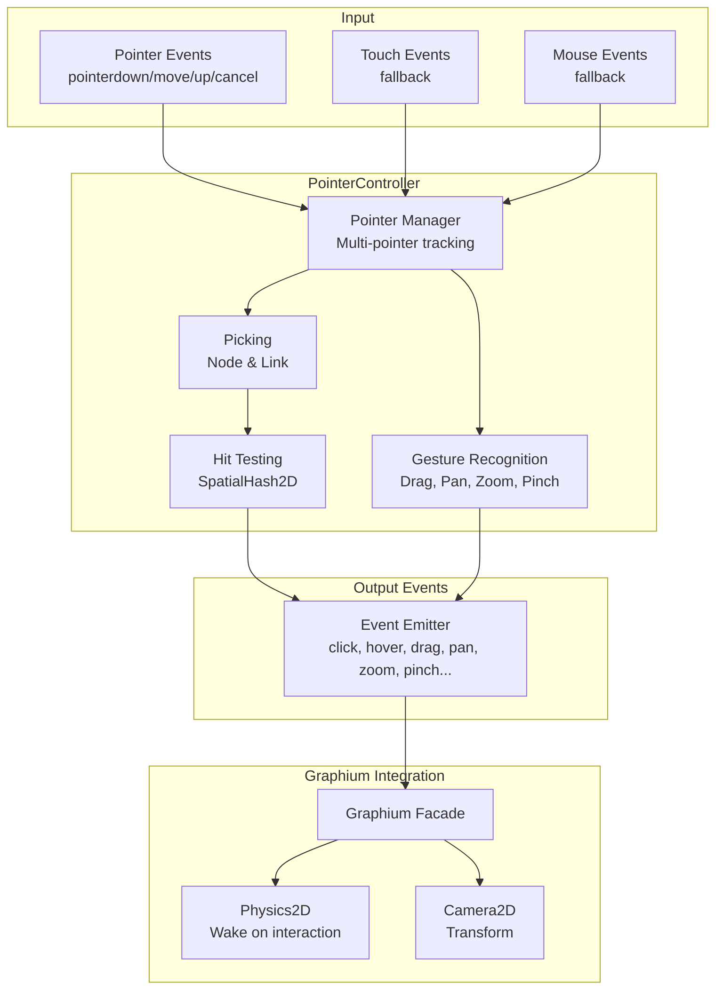
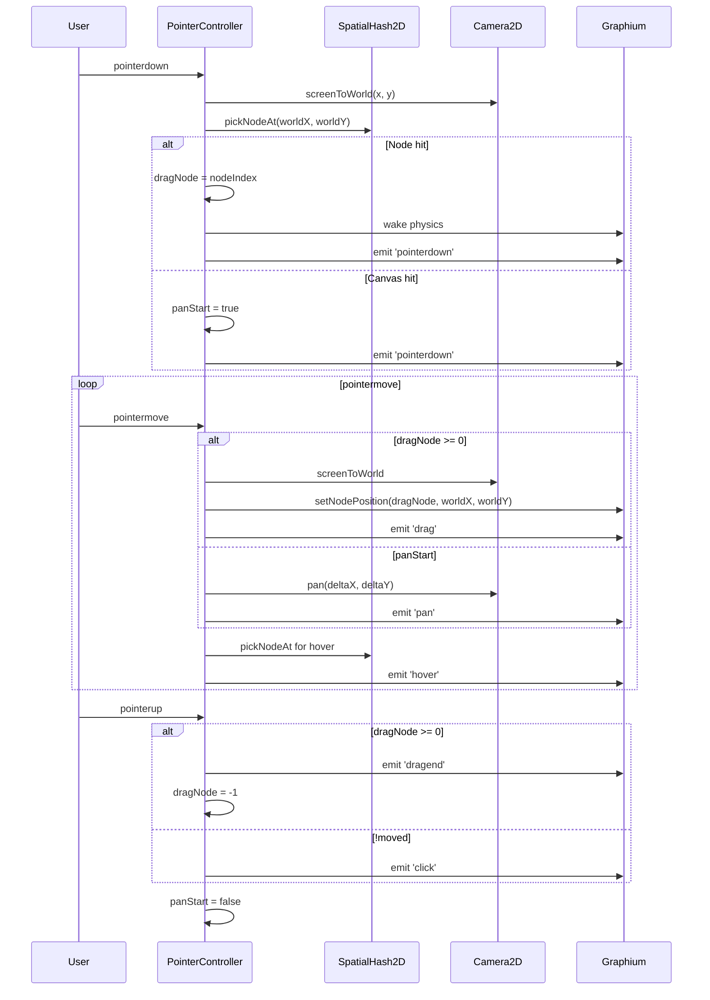
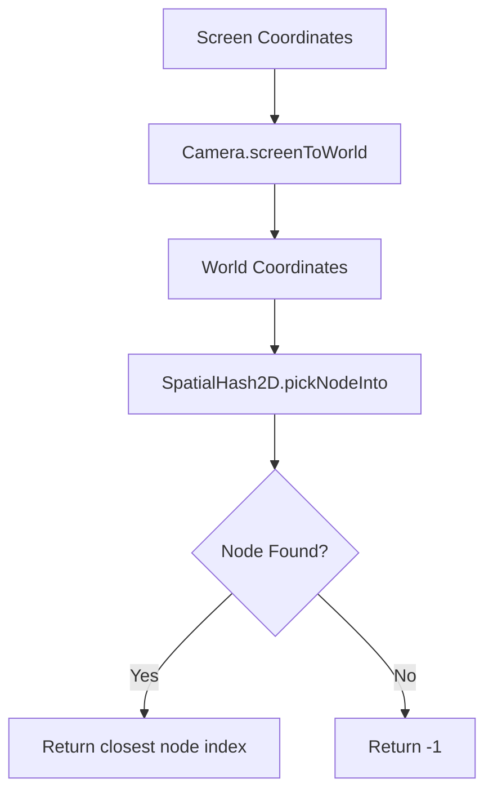
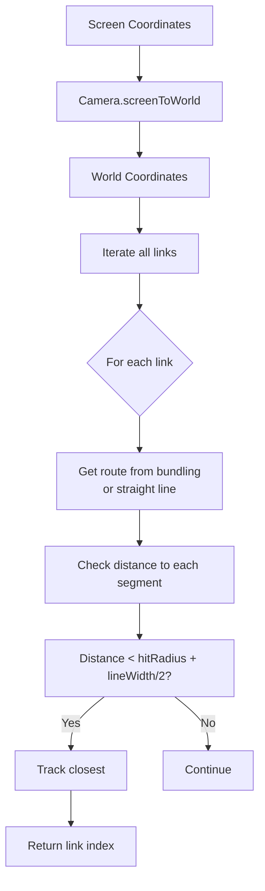
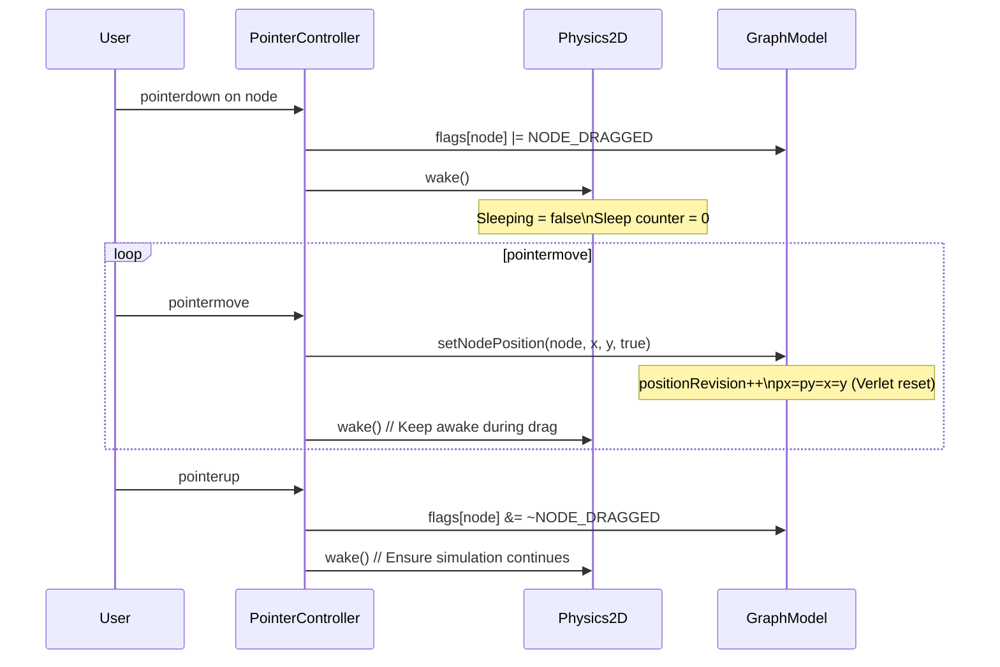

# Interaction System

The `PointerController` handles all pointer input (mouse, touch, pen) and translates it into graph interactions: node dragging, canvas panning, zooming, pinch-to-zoom, and picking.

---

## Architecture



---

## Pointer Management

### Multi-Pointer State

See `PointerController` in `src/interaction/PointerController.js`:

- `this.pointers` -- `Map` of `pointerId` → `{ x, y, startX, startY, time, target }`
- `this.primaryPointerId` -- primary pointer (first down), -1 if none
- `this.dragNode` -- node index being dragged, -1 if none
- `this.dragStartX`, `this.dragStartY` -- drag origin
- `this.moved` -- true if moved > `dragThreshold`

### Pointer Event Flow


---

## Gesture Recognition

### Drag (Node)
- **Trigger**: `pointerdown` on node → `pointermove` > `dragThreshold` (default 4px)
- **Action**: `graph.setNodePosition(nodeId, worldX, worldY, true)`
- **Physics**: Node marked as `NODE_DRAGGED` (mass = ∞, velocity = 0)
- **Events**: `dragstart`, `drag`, `dragend`

### Pan (Canvas)
- **Trigger**: `pointerdown` on empty canvas → `pointermove`
- **Action**: `camera.pan(deltaX, deltaY)`
- **Events**: `panstart`, `pan`, `panend`

### Zoom (Wheel)
- **Trigger**: `wheel` event
- **Action**: `camera.zoomAt(factor, screenX, screenY)`
- **Events**: `zoom`

### Pinch (Touch)
- **Trigger**: 2+ pointers, distance change
- **Action**: `camera.zoomAt(scale, centerX, centerY)`
- **Events**: `pinchstart`, `pinch`, `pinchend`

### Click / Double-Click
- **Trigger**: `pointerdown` + `pointerup` without significant movement
- **Timing**: Double-click within 300ms
- **Events**: `click`, `dblclick`

### Long Press
- **Trigger**: `pointerdown` held > 500ms without movement
- **Events**: `longpress`

### Context Menu
- **Trigger**: Right-click or long-press (configurable)
- **Events**: `contextmenu`

---

## Picking System

### Node Picking


- Uses `SpatialHash2D.pickNodeInto()` for O(1) lookup
- Searches within node's visual radius
- Returns closest node to pointer

### Link Picking


- **Hit radius**: Configurable (default 7px) + half line width
- **Bundled routes**: Uses actual spline segments for picking
- **Performance**: O(links) -- see `Graphium.pickLinkAt()` in `src/Graphium.js`

---

## Event System

All events emitted via `Graphium` facade. See `Graphium.on()` / `Graphium.emit()` in `src/Graphium.js` and `PointerController` in `src/interaction/PointerController.js`.

```javascript
graph.on('click', (event) => {
  // event: { nodeIndex, nodeId, linkIndex, linkId, worldX, worldY, originalEvent }
});

graph.on('hover', (event) => {
  // event: { nodeIndex, nodeId, worldX, worldY }
  // nodeIndex = -1 if no hover
});

graph.on('drag', (event) => {
  // event: { nodeIndex, nodeId, worldX, worldY }
});

graph.on('dragend', (event) => {
  // event: { nodeIndex, nodeId, worldX, worldY }
});

graph.on('pan', (event) => {
  // event: { worldX, worldY, deltaX, deltaY }
});

graph.on('zoom', (event) => {
  // event: { zoom, worldX, worldY, factor }
});

graph.on('pinch', (event) => {
  // event: { scale, centerX, centerY, worldX, worldY }
});

graph.on('longpress', (event) => {
  // event: { nodeIndex, nodeId, worldX, worldY }
});

graph.on('contextmenu', (event) => {
  // event: { nodeIndex, nodeId, linkIndex, linkId, worldX, worldY, preventDefault }
});
```

---

## Configuration

See `GraphiumOptions.interaction` in `src/Graphium.d.ts` and `PointerController` constructor in `src/interaction/PointerController.js`.

Options:
- `enabled` (default true) -- enable/disable all interaction
- `dragThreshold` (default 4) -- pixels to start drag
- `panEnabled` (default true), `panButton` (default 0 -- left)
- `zoomEnabled` (default true), `zoomSpeed` (default 1.2)
- `pinchEnabled` (default true)
- `doubleClickTime` (default 300ms), `longPressTime` (default 500ms)
- `hitRadius` (default 7) -- base hit radius for links
- `pickLink` -- custom link picker function

---

## Disabling / Customizing

See `Graphium` in `src/Graphium.js` and `PointerController` in `src/interaction/PointerController.js`.

```javascript
// Disable all interaction
const graph = new Graphium({ canvas, interaction: false });

// Disable specific gestures
const graph = new Graphium({
  canvas,
  interaction: { panEnabled: false, zoomEnabled: false, pinchEnabled: false }
});

// Custom link picker
const graph = new Graphium({
  canvas,
  interaction: { pickLink: (worldX, worldY, radius) => myCustomPicker(worldX, worldY, radius) }
});

// Disable after creation
graph.pointer.disable();

// Re-enable
graph.pointer.enable();

// Destroy (cleanup listeners)
graph.pointer.destroy();
```

---

## PointerController API

See `PointerController` in `src/interaction/PointerController.js`.

```javascript
const pointer = graph.pointer;

// Event subscription
pointer.on('click', callback);
pointer.off('click', callback);

// State queries
pointer.enabled;           // boolean
pointer.dragNode;          // node index being dragged, or -1
pointer.pointers.size;     // number of active pointers

// Manual control
pointer.destroy();         // Remove all listeners, cleanup
```

---

## Integration with Physics



**Key behaviors:**
- Dragged node: **infinite mass**, **zero velocity**, **position forced**
- Physics **wakes** on any interaction
- Position reset (`resetPrevious=true`) prevents velocity buildup on release
- Other nodes continue physics simulation during drag

---

## Touch-Specific Behavior

| Behavior | Implementation |
|----------|----------------|
| **No hover** | Touch doesn't generate `hover` events |
| **Scroll vs Pan** | Two-finger = pan, one-finger = drag node or pan canvas |
| **Pinch zoom** | Two-finger distance change → `camera.zoomAt()` |
| **Long press** | 500ms hold → `longpress` + `contextmenu` |
| **iOS Safari** | Requires `touch-action: none` on canvas |

```css
/* Required for proper touch handling */
canvas {
  touch-action: none;
  -webkit-touch-callout: none;
  -webkit-user-select: none;
  user-select: none;
}
```

---

## Extending Interaction

See `PointerController` in `src/interaction/PointerController.js`.

```javascript
class CustomPointerController extends PointerController {
  constructor(element, camera, model, spatialHash, options) {
    super(element, camera, model, spatialHash, options);
  }

  _onPointerDown(event) {
    const world = this.camera.screenToWorld2D(event.clientX, event.clientY);
    const customHit = this.myCustomPick(world.x, world.y);
    if (customHit) {
      this.emit('customhit', customHit);
      return;
    }
    super._onPointerDown(event);
  }
}

// Usage
const graph = new Graphium({ canvas, interaction: true });
graph.pointer = new CustomPointerController(
  canvas, graph.camera, graph.model, graph.spatialHash,
  graph.options.interaction
);
```

---

## Accessibility

- **Keyboard navigation**: Not built-in -- implement via `graph.setNodePosition()` and `graph.fit()`
- **Focus management**: Canvas receives focus on click
- **Screen readers**: No ARIA -- consider adding `role="img" aria-label="Graph visualization"`
- **Reduced motion**: Respect `prefers-reduced-motion` by disabling physics animation

```javascript
if (window.matchMedia('(prefers-reduced-motion: reduce)').matches) {
  graph.stop();
  graph.setPhysicsOptions({ positionIterations: 1 });
}
```