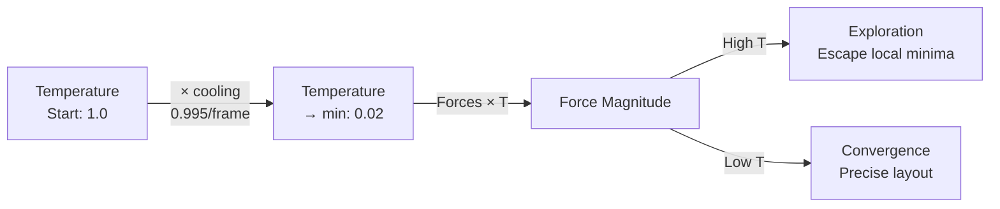
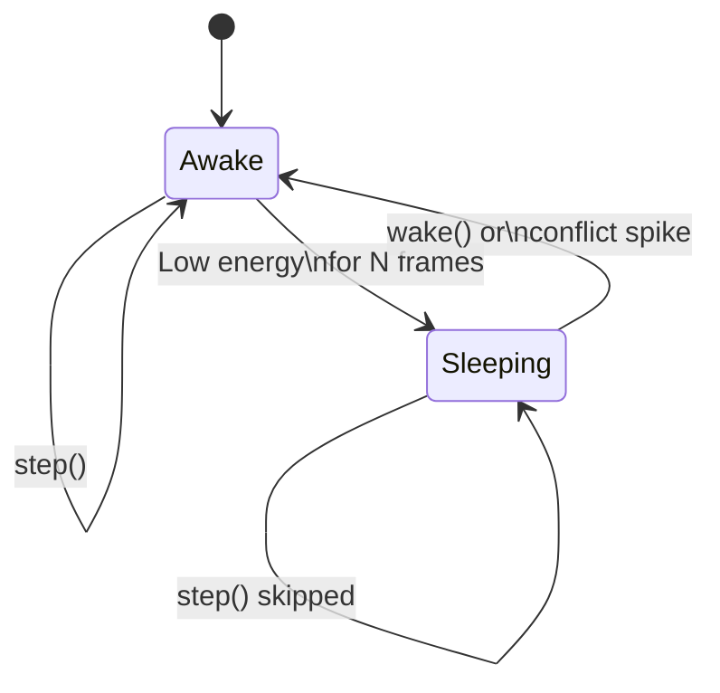
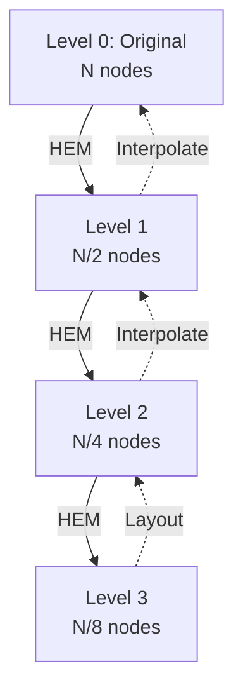

# Physics Engine

The physics engine (`Physics2D`) implements a **force-directed layout** using **Verlet integration** with comprehensive force models, collision resolution, edge conflict correction, and automatic sleep/wake.

---

## Force Model Overview

```mermaid
graph TD
    subgraph "Forces Applied Each Step"
        G[Gravity<br/>Center attraction]
        R[Repulsion<br/>Node-node Coulomb-like]
        S[Springs<br/>Link Hooke's law]
        C[Collision<br/>Hard constraint]
        EC[Edge Conflict<br/>Crossing/proximity correction]
        SC[Self Constraints<br/>Length preservation]
    end

    subgraph "Integration"
        V[Verlet<br/>x += (x - px) * damping + a * dt²]
    end

    subgraph "Post-Processing"
        SL[Sleep Detection<br/>Energy threshold]
        WK[Wake Triggers<br/>Interaction, conflicts]
    end

    G --> V
    R --> V
    S --> V
    C --> V
    EC --> V
    SC --> V
    V --> SL
    SL --> WK
```

---

## Verlet Integration

Position update uses **velocity Verlet** (simplified for overdamped systems). See `Physics2D._integrate()` in `src/physics/Physics2D.js`.

**Key properties:**
- **No explicit velocity storage** -- derived from `(x - px) / dt`
- **Damping baked into position difference** -- stable for overdamped systems
- **Fixed timestep by default** (`1/60`) -- deterministic, reproducible
- **Temperature scaling** -- multiplies all forces for simulated annealing

---

## Force Details

### 1. Center Gravity

See `Physics2D._applyCenterGravity()` in `src/physics/Physics2D.js`.

- Pulls nodes toward origin (0, 0): `force = -gravity * position * mass`
- Prevents disconnected components from drifting to infinity
- Strength: `options.gravity` (default `0.003`)

### 2. Node Repulsion (Coulomb-like)

See `Physics2D._applyRepulsionAndCollisions()` in `src/physics/Physics2D.js`. Uses `SpatialHash2D` for O(1) neighbor queries.

- For each neighbor within `repulsionRadius`:
  - `force = repulsion * degreeFactor / (distSq + minDist)`
  - `degreeFactor = degree_i^degreeExponent + degree_j^degreeExponent`
- **Degree scaling**: high-degree nodes repel more
- **Cutoff radius**: `repulsionRadius` (default 180) limits computation

### 3. Spring Forces (Links)

See `Physics2D._applySprings()` in `src/physics/Physics2D.js`.

- Hooke's law with rest length:
  - `force = springStrength * (dist - restLength)`
- **Rest length** initialized from initial distance or `restLength` option
- **Per-link strength** via `linkStrength` (default 0.08)
- **Length preservation** option for edge conflict resolution

### 4. Collision Resolution

See `Physics2D._applyRepulsionAndCollisions()` in `src/physics/Physics2D.js`.

- Hard constraint -- nodes cannot overlap:
  - `minDist = (radius_i + radius_j) * physicalRadiusScale`
  - `push = collisionStrength * (minDist - dist) / dist`
- **Physical radius** = `radius * physicalRadiusScale`
- Resolved via **position iterations** (`positionIterations`, default 3)

### 5. Edge Conflict Correction
Detects and corrects edge crossings, proximity overlaps, and alignment issues via repulsive forces.

---

## Temperature & Cooling (Simulated Annealing)



- **Initial temperature**: `options.temperature` (default 1.0)
- **Cooling rate**: `options.cooling` per frame (default 0.995)
- **Minimum temperature**: `options.minTemperature` (default 0.02)
- **All forces multiplied by temperature** -- enables global exploration early, precision late

---

## Sleep/Wake System



**Sleep criteria** (all must be true):
```javascript
combinedEnergy = kineticEnergy + edgeConflictEnergy * edgeConflictEnergyScale
combinedEnergy < sleepEnergy          // default 0.0008
AND edgeConflictEnergy < edgeConflictSleepThreshold  // default 0.02
FOR sleepFrames consecutive frames    // default 45
```

**Wake triggers:**
AND edgeConflictEnergy < edgeConflictSleepThreshold  // default 0.02
FOR sleepFrames consecutive frames    // default 45
```

**Wake triggers:**
- User interaction (drag, pan, zoom, click)
- `graph.wake()` or `physics.wake()`
- New node/link added
- Edge conflict energy spikes above `edgeConflictWakeThreshold` (default 0.2)
- `graph.setData()`, `graph.addNode()`, `graph.addLink()`

---

## Multi-Level Coarsening (Coarsening2D)

For large graphs (>500 nodes), coarsening creates hierarchy:



**Heavy-Edge Matching (HEM):**
1. Sort edges by weight (strength × inverse length)
2. Greedily match unmatched node pairs
3. Contract matched pairs into supernodes
4. Recurse until `minNodes` or `maxLevels` reached

**Configuration:**
```javascript
coarsening: {
  enabled: true,      // Auto-enabled for large graphs
  maxLevels: 8,       // Maximum hierarchy depth
  minNodes: 50        // Stop coarsening below this
}
```

---

## Energy Calculation

```javascript
// Kinetic energy (velocity-based)
kineticEnergy = 0.5 * Σ(mass * v²) for all moving nodes

// Edge conflict energy (from EdgeConflictDetector2D)
edgeConflictEnergy = Σ(severity²) for all conflict pairs

// Combined (used for sleep)
combinedEnergy = kineticEnergy + edgeConflictEnergy * edgeConflictEnergyScale
```

**Energy used for:**
- Sleep detection
- `physics.energy` property (exposed)
- `graph.getConflictEnergy()`

---

## Configuration Reference

```javascript
physics: {
  // Integration
  damping: 0.88,              // Velocity damping (0-1)
  maxSpeed: 1200,             // Max node speed (px/s)
  fixedDt: 1/60,              // Fixed timestep (s)

  // Forces
  gravity: 0.003,             // Center gravity strength
  repulsion: 900,             // Base repulsion force
  degreeFactor: 0.05,         // Degree scaling factor
  degreeExponent: 0.75,       // Degree scaling exponent
  repulsionRadius: 180,       // Repulsion cutoff (px)
  physicalRadiusScale: 1,     // Collision radius multiplier
  collisionStrength: 1,       // Collision resolution strength
  positionIterations: 3,      // Collision solver iterations
  springStrength: 0.08,       // Link spring constant

  // Temperature
  temperature: 1,             // Initial temperature
  cooling: 0.995,             // Cooling per frame
  minTemperature: 0.02,       // Minimum temperature

  // Sleep
  sleepEnergy: 0.0008,        // Sleep energy threshold
  sleepFrames: 45,            // Frames below threshold
  maxNeighbors: 256,          // Max neighbors per query

  // Edge Conflicts
  edgeRepulsionEnabled: true,
  edgeMinSeparation: 18,
  edgeRepulsionStrength: 0.8,
  edgeProximityStrength: 0.35,
  edgeAlignmentStrength: 0.5,
  crossingStrength: 1,
  crossingAngleStrength: 0.5,
  preferredCrossingAngle: Math.PI / 2,
  edgeRepulsionIterations: 2,
  edgeRepulsionMaxPairs: 10000,
  maxEdgeCorrection: 12,
  edgeConflictDamping: 0.85,
  preserveEdgeLength: 0.75,
  maxLengthRatio: 2.5,
  lengthStretchPenalty: 0.25,
  edgeConflictWakeThreshold: 0.2,
  edgeConflictSleepThreshold: 0.02,
  edgeConflictEnergyScale: 1,
  draggedNodeConflictWeight: 0.1,
  sharedEndpointExclusion: 0.18,
  edgeConflictCellSize: 48,
  edgeConflictEvents: false,
  edgeConflictRebuildThreshold: 1
}
```

---

## Performance Characteristics

| Graph Size | Typical FPS | Notes |
|------------|-------------|-------|
| 100 nodes, 200 links | 60 | Trivial |
| 1,000 nodes, 3,000 links | 60 | Spatial hash shines |
| 5,000 nodes, 15,000 links | 45-60 | Good performance with spatial hash |
| 10,000 nodes, 30,000 links | 30-45 | Higher density may lower FPS; consider reducing repulsionRadius or increasing damping |

**Optimization tips:**
- Set `nodeCapacity`/`linkCapacity` near expected size
- Reduce `repulsionRadius` for dense local clusters
- Use `fixedDt` for deterministic replay

---

## Extending Physics

```javascript
class CustomPhysics extends Physics2D {
  _applyCustomForces() {
    const { x, y, fx, fy, mass, flags } = this.model;
    for (let i = 0; i < this.model.nodeCount; i++) {
      if (flags[i] & (NODE_FIXED | NODE_DRAGGED)) continue;
      // Add your force to fx[i], fy[i]
      fx[i] += myForceX(i);
      fy[i] += myForceY(i);
    }
  }

  step(dt) {
    this._applyCustomForces();
    return super.step(dt);
  }
}

// Use it
const graph = new Graphium({ canvas });
graph.physics = new CustomPhysics(graph.model, graph.spatialHash, graph.options.physics);
```