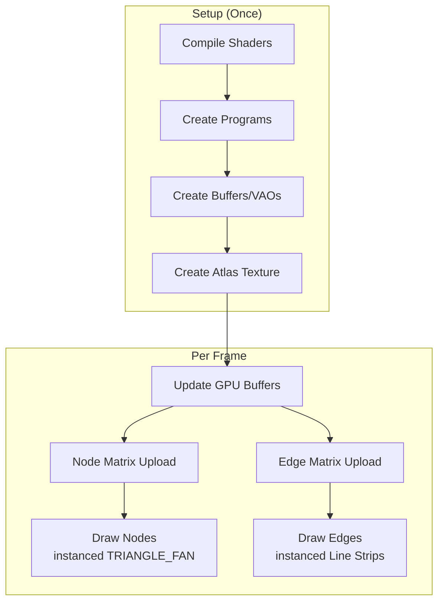
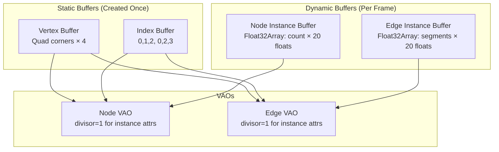

# WebGL2 Rendering

The renderer (`WebGLRenderer2D`) uses **instanced rendering** for maximum throughput -- single draw call per node/edge type regardless of count.

---

## Rendering Pipeline



---

## Instanced Rendering

### Nodes
- **Primitive**: `TRIANGLE_FAN` (4 vertices = quad)
- **Instances**: 1 per visible node
- **Attributes** (per-instance, `divisor = 1`):
  | Location | Name | Type | Data |
  |----------|------|------|------|
  | 1 | `aNode` | `vec4` | `x, y, visualRadius, flags` |
  | 2 | `aFill` | `vec4` | Packed RGBA fill color |
  | 3 | `aBorder` | `vec4` | Packed RGBA border color |
  | 4 | `aStyle` | `vec4` | `borderWidth, borderOpacity, state, visualRadiusScale` |
  | 5 | `aImage` | `vec4` | `atlasIndex, hasImage, 0, 0` |

### Edges
- **Primitive**: `LINE_STRIP` (variable vertices per edge)
- **Instances**: 1 per edge segment
- **Attributes** (per-instance):
  | Location | Name | Type | Data |
  |----------|------|------|------|
  | 1 | `aSegment` | `vec4` | `x1, y1, x2, y2` (world coords) |
  | 2 | `aColor` | `vec4` | Packed RGBA |
  | 3 | `aStyle` | `vec4` | `width, dashLength, dashGap, dashOffset` |
  | 4 | `aMeta` | `vec4` | `isDashed, dashScaleWithZoom, 0, 0` |

---

## Shaders

Full shader sources are in `src/render/WebGLRenderer2D.js` as template literals:
- `NODE_VERTEX` -- node vertex shader
- `NODE_FRAGMENT` -- node fragment shader
- `EDGE_VERTEX` -- edge vertex shader
- `EDGE_FRAGMENT` -- edge fragment shader

### Node Vertex Shader (`NODE_VERTEX`)
- Transforms quad corners to world space using `aNode` (x, y, visualRadius, flags)
- Computes atlas UV coordinates for avatar images
- Passes color, border, style, and image data to fragment shader

### Node Fragment Shader (`NODE_FRAGMENT`)
- Renders circular nodes with anti-aliased edges
- Supports hover/selected/fixed/disabled state rings
- Handles avatar atlas texture blending
- Renders borders with configurable width

### Edge Vertex Shader (`EDGE_VERTEX`)
- Expands line segments to thick lines using `aCorner` (-1, 1) for sides
- Computes dash pattern positions in world space
- Passes color, dash pattern, and style to fragment shader

### Edge Fragment Shader (`EDGE_FRAGMENT`)
- Renders solid or dashed lines with anti-aliased edges
- Discards fragments in dash gaps
- Outputs premultiplied alpha for correct blending

---

## Avatar Atlas

See `WebGLRenderer2D` in `src/render/WebGLRenderer2D.js`.

- **8×8 grid** = 64 slots in single 1024×1024 (configurable) texture
- **Dynamic allocation** -- images loaded on-demand, LRU eviction
- **Packed into shader** via `aImage.x` (atlas index) and `aImage.y` (has image flag)

Key methods:
- `allocateSlot(url)` -- assigns atlas slot, loads image
- `getImageSlot(url)` -- retrieves existing slot
- `uploadAtlas()` -- uploads texture to GPU

---

## Camera & View Matrix

See `Camera2D` in `src/render/Camera2D.js`.

- Computes 3x3 matrix: `[scale, 0, tx; 0, scale, ty; 0, 0, 1]` where `scale = zoom`, `(tx, ty) = pan offset`
- Methods: `worldToScreen2D()`, `screenToWorld2D()`, `fit()`, `pan()`, `zoomAt()`

---

## Buffer Management



- **Node buffer size**: `nodeCount × 5 attributes × 4 floats = 20 floats/node`
- **Edge buffer size**: `segmentCount × 5 attributes × 4 floats = 20 floats/segment`
- **Auto-growth**: Buffers double when capacity exceeded
- **Orphan + reallocate** for smooth resizing

---

## Render States

See `WebGLRenderer2D.render()` in `src/render/WebGLRenderer2D.js`.

- Blending: `SRC_ALPHA` / `ONE_MINUS_SRC_ALPHA` (RGB), `ONE` / `ONE_MINUS_SRC_ALPHA` (Alpha)
- Depth test: disabled (2D)
- Culling: disabled

---

## Performance Features

| Feature | Implementation |
|---------|----------------|
| **Instanced draws** | 1 draw call for all nodes, 1 for all edges |
| **Frustum culling** | CPU-side: skip nodes outside view + radius |
| **Atlas texture** | Single bind for all images |
| **Packed colors** | Single `Uint32Array` → unpacked in shader |
| **Dirty tracking** | Only re-upload changed instances (appearanceRevision) |
| **OffscreenCanvas support** | Works in Web Workers |

---

## Configuration

See `WebGLRenderer2D` constructor in `src/render/WebGLRenderer2D.js`.

Options:
- Canvas/Context: `canvas`, `antialias`, `alpha`, `premultipliedAlpha`, `preserveDrawingBuffer`
- Atlas: `atlasSize` (default 1024), `maxAtlasSlots` (default 64)
- Quality: `pixelRatio` (default `devicePixelRatio`), `lineCap`, `lineJoin`

---

## Edge Star Mode

`StarClusterRoutes` is an optional edge-routing provider that changes how links
inside **fully connected clusters of 3+ nodes (cliques)** are drawn. When
enabled, every intra-clique edge is rendered as a two-segment polyline that
passes through the cluster's virtual center (the live centroid of its member
positions): `node A -> centroid -> node B`. Links outside any clique keep their
straight source->target segment.

### Activation

```javascript
const graph = new Graphium({ canvas, edgeStar: true });
// or toggle at runtime:
graph.setEdgeStar(true);
graph.setEdgeStar(false);
```

### Implementation

- `StarClusterRoutes` implements the `routes` protocol consumed by
  `WebGLRenderer2D.render(model, routes)` (`getPointCount(index)` /
  `getRoute(index)`); `Graphium.render()` passes it to the renderer.
- Clusters are maximal cliques grown greedily in descending degree order
  (**node-disjoint**: each node belongs to at most one star cluster, larger
  clusters win).
- Adjacency and clusters are rebuilt lazily only when `model.topologyRevision`
  changes (adding/removing nodes/links, `setData`, `clear`); centroids are
  recomputed once per frame from the live physics positions.
- Picking (`pickLinkAt`) follows the star polyline segments, so clicks and
  hovers match what is drawn.
- Physics is unaffected — only the drawn geometry changes.

### Known behavior

- When a node has multiple edges in the same clique, the shared
  node->centroid segments overlap exactly. This is expected (the overdraw makes
  the node->hub "spoke" read as a single thicker line) and can be shaped via
  `appearance.edgeOpacity`.
- Clique detection uses all links regardless of direction/duplicates
  (multi-edges are deduplicated for adjacency).

---

## Extending Renderer

See `WebGLRenderer2D` in `src/render/WebGLRenderer2D.js` for base implementation.

```javascript
class CustomRenderer extends WebGLRenderer2D {
  constructor(canvas, options) {
    super(canvas, options);
    this.customProgram = this.createCustomProgram();
  }

  createCustomProgram() {
    const vs = `#version 300 es ...`;
    const fs = `#version 300 es ...`;
    return this.createProgram(vs, fs);
  }

  render(model) {
    super.render(model);
    this.drawCustom(model);
  }

  drawCustom(model) {
    const gl = this.gl;
    gl.useProgram(this.customProgram);
    // ... bind buffers, draw
  }
}

// Usage
const graph = new Graphium({ canvas, renderer: { customOption: true } });
graph.renderer = new CustomRenderer(canvas, { appearance: graph.options.appearance });
graph.renderer.setCamera(graph.camera);
```